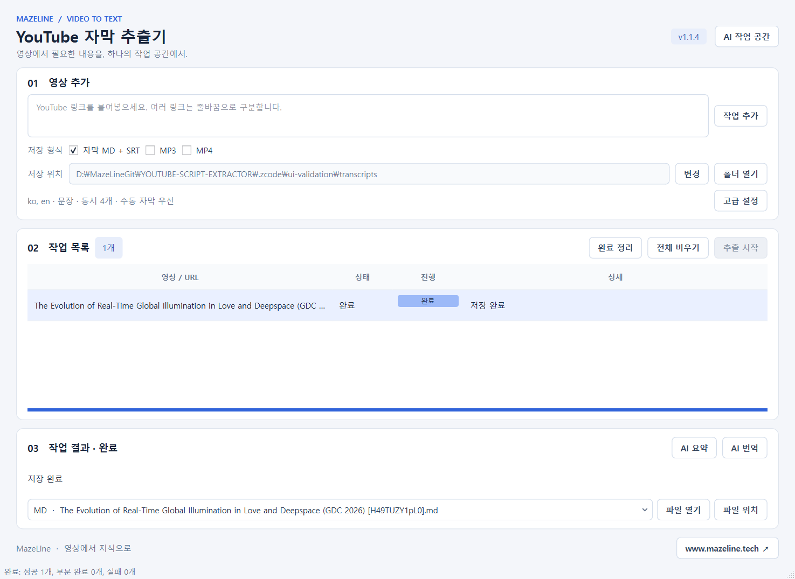
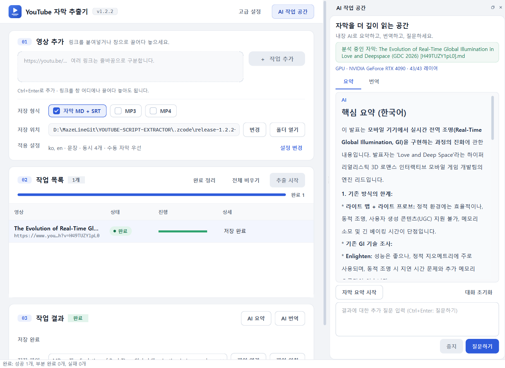

# YouTube 자막 추출기 (YouTube Transcript Extractor)

[](https://github.com/mazelines/YOUTUBE-SCRIPT-EXTRACT/releases/tag/release-1.2.0)
[](LICENSE)


YouTube 영상 링크를 입력하면 자막(transcript)을 추출해 **마크다운(.md)**과 **원문 SRT(.srt)** 파일로 함께 저장하고, 선택적으로 **MP3 음원**과 **MP4 영상**도 내려받는 데스크톱 프로그램입니다. Qt 6(PySide6) 기반 GUI이며, **여러 영상을 동시에** 추출할 수 있습니다.



*버전 1.2.0의 UI 개편 화면을 Windows에서 직접 캡처했습니다.*

## 개발 언어 및 기술 구성

| 구분 | 사용 기술 |
|------|-----------|
| 주요 개발 언어 | Python 3.10 이상 |
| 데스크톱 UI | PySide6 / Qt 6 |
| 자막·영상 처리 | youtube-transcript-api, yt-dlp, FFmpeg, Node.js / EJS |
| 내장 AI·음성 인식 | llama-cpp-python, pywhispercpp |
| 빌드·실행 스크립트 | PowerShell, Windows Batch, PyInstaller |

프로젝트 라이선스는 **[MIT](LICENSE)**입니다. 포함된 라이브러리와 AI 모델에는 각 구성요소의 라이선스가 적용됩니다.

## 주요 기능

- **다중 URL 입력** — 여러 줄로 붙여넣어 한 번에 목록에 추가
- **동시 추출** — `QThreadPool` 기반 병렬 처리 (동시 작업 수 1~16 조절)
- **자막 → Markdown + SRT** — 메타데이터를 포함한 Markdown과 원문 구간·시간을 보존한 SRT 동시 저장
- **포맷 선택** — 문장 단위 / 단락 단위 / 타임스탬프 포함 3가지 형식
- **MP3 음원 추출** — yt-dlp + 동봉 ffmpeg로 음원만 추출 (128 / 192 / 320 kbps)
- **MP4 영상 다운로드** — 화질 선택(1080p / 720p / 원본), H.264 우선으로 어느 플레이어에서나 재생 (재인코딩 없이 mp4 컨테이너로 remux)
- **언어 우선순위** — 예: `ko, en, ja` 순으로 자막 탐색, 수동 자막 우선/번역 폴백
- **라이브 영상 / 자막 없는 영상 지원** — 자막이 없을 때 (1) YouTube 자동 자막 생성 대기(폴링), (2) 내장 Whisper(whisper.cpp) STT로 자동 자막 생성 중 택일. 라이브 중인 영상은 지정한 시간만큼 캡처해 변환 ([STT 폴백](#stt-폴백--라이브-영상-지원) 참고)
- **작업 중심 화면** — 영상 추가 → 작업 목록 → 결과 확인 순서로 구성, 고급 설정은 별도 창에서 조절
- **실시간 진행 표시** — 작업별 상태와 측정 가능한 진행률 표시, 처리량을 알 수 없는 단계는 진행 중으로 안내
- **결과 파일 선택** — 선택한 작업의 MD·SRT·MP3·MP4와 저장된 AI 번역을 골라 열거나 파일 위치 확인
- **스플래시 화면** — 메인 UI와 같은 디자인의 [시작 화면](docs/screenshot-splash.png), 로딩 애니메이션과 버전 표시
- **자동 업데이트 확인** — 시작 시 백그라운드로 최신 버전 확인

## AI 채팅

작업을 선택하고 결과 영역의 **AI 요약** 또는 **AI 번역**을 누르면 해당 자막으로 **AI 작업 공간**이 열립니다. 상단 버튼으로 패널을 다시 열거나 닫을 수 있으며, 패널을 닫아도 진행 중인 추론과 대화는 유지됩니다. 작은 창에서는 별도 창으로 열려 추출 화면을 가리지 않도록 이동할 수 있습니다.



- **요약 탭** — 자막 핵심 내용을 한국어로 요약
- **번역 탭** — 자막 전체를 한국어로 번역, 완료 시 자동으로 `.ko.md` 파일로 저장 (체크박스 옵션)
- **기본 제공자** — 앱 내장 모델(**Gemma 4 E4B**, Apache-2.0), 첫 사용 시 Hugging Face에서 자동 다운로드(약 5.3GB), 이후 오프라인 동작
- **GPU 가속** — NVIDIA·AMD·Intel GPU 감지 시 Vulkan으로 자동 가속 (CPU 대비 ~10~20배), 없으면 CPU 동작
- **내장 모델 사용** — 현재 앱 UI는 별도 API 키 없이 내장 모델로 동작

### llama-cpp-python 설치 (내장 모델 사용 시)

> **Windows Long Path 필수**: llama-cpp-python이 vendoring하는 `llama.cpp` 트리에 260자를 넘는 Svelte 경로가 있어, 기본 Windows에서는 `OSError: [Errno 2] No such file or directory: ...ChatAttachmentsListItemMcpPrompt.svelte`로 설치가 실패합니다. 동봉된 **`enable_long_paths.bat`**을 한 번 실행(관리자 권한, UAC 승인)하면 시스템 전체에 long path가 활성화되어 재부팅 없이 해결됩니다. Python 3.6+ 인스톨러는 이미 `longPathAware` 매니페스트를 포함하므로 레지스트리만 켜면 pip이 자동으로 긴 경로를 처리합니다.

> **AVX512 주의**: 사전빌드 휠은 AVX512로 컴파일돼 있어 대부분의 컨슈머 CPU에서 죽습니다. 반드시 **AVX2 소스 빌드**하세요.

```bash
# Windows (MSVC + CMake/Ninja 필요)
set CMAKE_ARGS=-DGGML_NATIVE=OFF -DGGML_AVX2=ON -DGGML_FMA=ON -DGGML_F16C=ON -DGGML_AVX512=OFF -DCMAKE_C_FLAGS=/utf-8 -DCMAKE_CXX_FLAGS=/utf-8
pip install "llama-cpp-python>=0.3.0" --no-binary llama-cpp-python --no-cache-dir
```

## STT 폴백 / 라이브 영상 지원

YouTube가 아직 자막을 만들지 않은 **라이브 중인 영상**이나 **자막이 비활성화된 VOD**에서도 자막을 얻을 수 있습니다. 두 단계 폴백이 순차적으로 동작합니다.

1. **자막 생성 대기(폴링)** — YouTube가 곧 자동 자막을 만들 경우를 대비해, 지정한 시간(기본 0분 — 끄짐) 동안 1분 간격으로 재시도합니다. 라이브가 곧 자막을 켤 것 같을 때만 값을 올립니다.
2. **STT 자동 생성** — 폴링까지 실패하면 음성을 내려받아 [whisper.cpp](https://github.com/ggerganov/whisper.cpp)([pywhispercpp](https://github.com/absadiki/pywhispercpp) 바인딩)로 텍스트를 생성합니다. 결과는 `.stt.md`와 `.stt.srt`로 저장되어 YouTube 공식 자막과 구분됩니다.

| 상황 | 동작 |
|------|------|
| VOD + 자막 있음 | 기존처럼 자막 추출 (가장 우선) |
| VOD + 자막 없음 + STT 켬 | 음성 전체 다운로드 → Whisper 변환 |
| 라이브 + 자막 있음 | 기존처럼 자막 추출 |
| 라이브 + 자막 없음 + 폴링만 | 자막 생성 시점까지 주기적 재시도 |
| 라이브 + 자막 없음 + STT + 캡처시간 > 0 | 수신한 라이브 스트림을 지정한 시간만큼 캡처해 STT로 변환 |
| 라이브 + 자막 없음 + STT + 캡처시간 = 0 | 안내 메시지 ("종료 후 재시도 또는 캡처 시간 지정") |

> **라이브 캡처**: yt-dlp로 스트림 주소를 확인한 뒤 FFmpeg로 지정한 시간만큼 녹음합니다. 방송 시작부터의 전체 녹화를 보장하지 않으며, 스트림 상태나 접근 제한에 따라 실패할 수 있습니다.

### STT 구성요소 설치 (pywhispercpp, STT 폴백 사용 시)

llama-cpp-python과 마찬가지로 **선택 의존성**입니다. 설치하지 않아도 자막/MP3/MP4 추출은 그대로 동작하며, STT 옵션만 비활성화됩니다.

STT 엔진은 AI 채팅(llama.cpp)과 **같은 ggml 스택**인 whisper.cpp입니다. Vulkan 소스 빌드 하나로 **NVIDIA/AMD/Intel 모든 GPU**가 가속되고, GPU가 없으면 자동으로 AVX2 CPU 백엔드로 동작합니다 — CUDA 전용 휠(~600MB)이 필요 없습니다. 빌드 절차는 `requirements-stt.txt`의 주석을 참고하세요 (llama-cpp-python Vulkan 빌드와 동일한 패턴). GPU 가속 없이 CPU만 쓸 거라면 `pip install -r requirements-stt.txt`(PyPI CPU 휠)로 충분합니다.

- 첫 사용 시 STT 체크박스를 켜고 추출을 시작하면, 선택한 모델(`tiny`/`base`/`small`/`medium`/`large-v3`)을 Hugging Face([ggerganov/whisper.cpp](https://huggingface.co/ggerganov/whisper.cpp))에서 자동으로 내려받아 `%LOCALAPPDATA%\YouTubeTranscriptExtractor\stt-models`에 캐싱합니다. 이후 오프라인 동작.
- **GPU 자동 사용**: Vulkan을 초기화할 수 있으면 GPU로, 아니면 CPU로 — 별도 설정이 없습니다. 수동 제어는 환경변수 `STT_USE_GPU=0`(GPU 강제 끔)으로 가능합니다.

> **속도 가이드 (282초 오디오, small 모델, 실측)**:
> | 백엔드 | 변환 시간 | 배속 |
> |--------|----------|------|
> | GPU Vulkan (RTX 4090) | 2.0초 | 141x 실시간 |
> | CPU AVX2 | 20.5초 | 13.8x 실시간 |
>
> 1시간 영상 = small+CPU 약 4분 / small+GPU 약 30초. GPU가 있다면 medium도 부담 없습니다.

> **VAD 필터**: 사용하지 않습니다. (구 faster-whisper 시절 Silero VAD가 노래/음악을 speech로 인식하지 못해 음악 영상에서 빈 결과가 나왔던 문제로 제거.) Whisper 자체가 무음 구간을 attention으로 처리하므로 VAD 없이도 품질에 문제가 없습니다.

## 설치 및 실행

**원클릭 (Windows, 권장)** — `run_dev.bat`을 더블클릭하면 가상환경(`.venv`) 생성 + 전체 의존성(자막/MP3/MP4 + AI 채팅 + STT 폴백) 설치 후 GUI가 자동 실행됩니다. 두 번째 실행부터는 설치를 건너뛰고 바로 뜹니다.

```bat
run_dev.bat                 :: 더블클릭 또는 터미널에서 실행 → GUI 실행
run_dev.bat --selftest      :: 빌드 검증만 수행 (GUI 미실행)
```

> `run_dev.bat`은 llama-cpp-python / pywhispercpp 설치 실패를 자동으로 건너뛰고 해당 기능만 비활성화합니다. 핵심 자막/MP3/MP4 추출은 항상 동작합니다.

**수동 설치**:

```bash
pip install -r requirements.txt
python run.py
```

Python 3.10 이상 필요.

소스에서 실행할 때 YouTube 영상 다운로드에는 **Node.js 22 이상**(PATH 등록)이 필요합니다.
`python -m pip install -U -r requirements.txt`로 yt-dlp와 EJS 구성요소를 함께 갱신하세요.
Windows 배포 ZIP에는 Node.js와 EJS가 포함되므로 사용자가 따로 설치할 필요가 없습니다.

## 릴리스 빌드 (Windows 실행파일)

릴리스는 로컬 빌드 → EXE 자체 검사 → ZIP 생성으로 끝납니다. Google Drive 등 클라우드 업로드는 포함하지 않습니다.

빌드 환경에도 Node.js 22 이상이 필요합니다. 빌드 시 해당 Node 버전의 라이선스를
공식 저장소에서 받아 실행 파일과 함께 포함합니다(이후 로컬 캐시 사용).

```powershell
.\.venv\Scripts\Activate.ps1
python -m pip install pyinstaller
.\scripts\release.ps1
# 결과: dist/YouTubeTranscriptExtractor/ 폴더 및 dist/YouTubeTranscriptExtractor.zip

.\scripts\release.ps1 -SkipBuild  # 기존 빌드 자체 검사 후 ZIP 생성
.\scripts\release.ps1 -Versioned  # dist/에 날짜별 ZIP도 추가 생성
```

빌드 검증:
```bash
dist\YouTubeTranscriptExtractor\YouTubeTranscriptExtractor.exe --selftest
```

## 별도 수동 FTP 업로드

기존 FTP 도구는 기본 릴리스 절차에 포함하지 않으며, 명시적으로 업로드할 때만 실행합니다.

`ftp-config.example.json`을 복사해 `ftp-config.json`을 만들고 비밀번호를 채운 뒤:

```bash
python scripts/deploy.py            # 빌드 zip + 매니페스트 + 업로드
python scripts/deploy.py --check    # FTP 연결 테스트만
python scripts/deploy.py --dry-run  # 업로드 없이 목록 확인
```

업로드 대상: `mazeline.tech/updates/youtubeTranscriptExtractor/`

## 사용법

1. YouTube URL을 한 줄에 하나씩 붙여넣고 **작업 추가**를 누릅니다. 입력창에서 `Ctrl+Enter`를 눌러도 추가됩니다. 인식할 수 없는 링크는 수정할 수 있도록 입력창에 남습니다.
2. **저장 형식**에서 `자막 MD + SRT` / `MP3` / `MP4`를 선택합니다. 여러 형식을 함께 선택할 수 있으며 MP3·MP4를 켜면 음질·화질 설정이 나타납니다.
3. **저장 위치**를 확인하고, 필요한 경우 **고급 설정**에서 언어 우선순위, 수동 자막 우선, Markdown 형식, 동시 작업 수를 조절합니다. 설정 창을 닫아도 값이 유지되며 현재 설정 요약이 메인 화면에 표시됩니다.
4. **한국어 번역도 저장**을 켜면 제공되는 YouTube 한국어 번역 자막과, 이후 완료한 AI 전체 번역을 `.ko.md`로 저장합니다. AI 후속 질문이나 중지한 번역은 기존 번역 파일을 덮어쓰지 않습니다.
5. 자막이 없는 영상은 고급 설정에서 **음성 인식으로 자막 생성**을 켭니다. 모델과 라이브 수집 시간을 지정할 수 있습니다. **YouTube 자막 대기**는 음성 인식과 독립된 옵션이며 기본값은 대기 안 함입니다.
6. 작업 목록의 **추출 시작**을 누릅니다. SRT는 Markdown 형식과 무관하게 원문 구간과 시작·종료 시간을 보존합니다. 음성 인식 결과는 `.stt.md`와 `.stt.srt`로 구분합니다.
7. 작업을 선택하면 결과 영역에서 상세 상태·오류와 저장 파일을 확인할 수 있습니다. 파일을 고른 뒤 **파일 열기** 또는 **파일 위치**를 누릅니다. 표의 항목을 더블클릭하면 첫 번째 저장 파일이 열립니다.
8. 자막이 저장된 작업에서 **AI 요약** 또는 **AI 번역**을 누릅니다. AI 작업 공간에는 분석 중인 자막 이름이 표시되며, `중지` 버튼으로 추론을 멈출 수 있습니다.

작은 화면이나 높은 Windows 배율에서는 메인 화면과 설정 창을 세로로 스크롤할 수 있습니다. **완료 정리**는 완료·부분 완료·실패 항목을 목록에서 지우며 저장된 파일은 삭제하지 않습니다.

> **ffmpeg 안내**: MP3 변환과 MP4 영상 병합·remux에는 ffmpeg가 필요합니다. `imageio-ffmpeg`가 ffmpeg 바이너리를 함께 제공하므로 별도 설치 없이 동작합니다.

기본 저장 위치는 Windows 문서 폴더 아래 `YouTubeTranscriptExtractor/transcripts/`이며, 문서 폴더를 사용할 수 없으면 사용자 데이터 폴더를 사용합니다. 앱에 표시된 **저장 위치**에서 실제 경로를 확인할 수 있습니다.

## 출력 예시

```markdown
# 영상 제목

- **URL**: https://www.youtube.com/watch?v=VIDEO_ID
- **영상 ID**: VIDEO_ID
- **채널**: 채널명
- **자막 언어**: Korean (`ko`, 수동 작성)
- **추출 시각**: 2026-05-25 14:30:00

---

## Transcript

안녕하세요, 오늘은 유니티에서 캐릭터를 추가하는 방법에 대해 알아보겠습니다.
```

## 프로젝트 구조

```
YOUTUBE-SCRIPT-EXTRACTOR/
├── run.py                        # 실행 진입점
├── run_dev.bat                   # 원클릭 dev 런처 (.venv 생성 + 의존성 설치 + GUI 실행)
├── enable_long_paths.bat         # (1회성) Windows Long Path 활성화 — llama-cpp-python 설치용
├── requirements.txt
├── YouTubeTranscriptExtractor.spec   # PyInstaller 빌드 스펙
├── scripts/
│   └── deploy.py                 # 빌드 ZIP 패킹 + FTP 배포
├── ftp-config.example.json       # FTP 설정 템플릿
└── yt_extractor/
    ├── __init__.py               # 버전 정보
    ├── app.py                    # PySide6 (Qt 6) GUI 메인
    ├── ui_layout.py              # 작업 공간·고급 설정·결과 영역 구성
    ├── theme.py                  # 실행·스크린샷에 공통 적용하는 UI 테마
    ├── core.py                   # 추출 로직 (URL 파싱·자막·MP3·MP4·마크다운·폴백)
    ├── chat_render.py            # AI 채팅 HTML 렌더러
    ├── local_llm.py              # 내장 llama-cpp-python LLM 래퍼
    ├── stt.py                    # (선택) whisper.cpp(pywhispercpp) STT 래퍼 — 자막 없는/라이브 영상
    ├── splash.py                 # 스플래시 화면
    ├── updater.py                # 업데이트 확인 (백그라운드 QThread)
    └── img/
        └── mazelinebanner.jpg
```

`core.py`는 GUI에 의존하지 않으므로 CLI 등 다른 프론트엔드에서도 재사용할 수 있습니다. `stt.py`는 pywhispercpp가 설치된 경우에만 로드되며, 없으면 STT 옵션이 자동으로 비활성화됩니다.

## 구현 가이드 (개발자용)

### MP4 영상 추출

`extract_video()` 함수는 yt-dlp를 사용해 YouTube 영상을 MP4로 다운로드합니다.

```python
from yt_extractor.core import extract_video

# 1080p 영상 다운로드 (H.264 우선)
mp4_path = extract_video(url, output_dir, height=1080)
```

**구현 세부사항:**

1. **포맷 선택 로직** (`core.py:847-851`):
   - H.264(`vcodec^=avc1`) 우선 → 호환성 최우선
   - AV1/VP9는 일부 플레이어에서 재생 불가 (예: Windows 기본 플레이어)
   - 원본 화질 요청 시 `height=0` 전달

2. **재인코딩 없는 remux** (`core.py:856`):
   - `FFmpegVideoRemuxer`로 컨테이너만 MP4로 변경
   - 화질 손실 없이 빠른 처리 (seconds 단위)

3. **병렬 다운로드** — yt-dlp 내장 fragment 병렬 다운로더(`concurrent_fragment_downloads`)를 사용합니다.

   > **다운로드 실패 원인(해결됨):** 과거에는 aria2c를 외부 다운로더로 사용했으나, YouTube + Windows 환경에서 aria2c가 `WSAENETUNREACH`(unreachable network) 에러로 종료(exit 1)되어 **MP3·MP4 다운로드가 모두 실패**했습니다. aria2c 경로를 제거하고 네이티브 다운로더로 통일해 해결했습니다. (`_download_accel_opts()` 참고)

4. **취소 지원**:
   - `should_cancel` 콜백으로 진행 중인 작업 중단 가능
   - yt-dlp hook 내부에서 `_Cancelled` 예외 발생

### MP3 음원 추출

`extract_audio_mp3()`는 동일한 `_download()` 파이프라인을 사용합니다.

```python
from yt_extractor.core import extract_audio_mp3

# 192kbps MP3 추출
mp3_path = extract_audio_mp3(url, output_dir, bitrate="192")
```

포맷: `bestaudio/best` → `FFmpegExtractAudio` postprocessor.

### 확장: 새로운 포맷 추가

`_download()`는 일반적인 다운로드 파이프라인입니다. 예를 들어 WEBM 추출:

```python
def extract_webm(url, out_dir, **kwargs):
    return _download(
        url, out_dir,
        fmt="bestvideo+bestaudio",
        postprocessors=[{"key": "FFmpegVideoRemuxer", "preferedformat": "webm"}],
        out_ext="webm",
        merge_output_format="webm",
        **kwargs
    )
```

## 참고

- 자막은 YouTube가 제공하는 경우에 가장 정확합니다. 자막이 없는 영상(비활성화·라이브 중)은 **STT 폴백** 옵션으로 처리할 수 있습니다 — [STT 폴백 / 라이브 영상 지원](#stt-폴백--라이브-영상-지원) 참고.
- STT로 생성한 자막은 `.stt.md`와 `.stt.srt`로 저장되어 YouTube 공식 자막과 구분됩니다.
- 짧은 시간에 많은 요청을 보내면 YouTube가 일시적으로 IP를 제한할 수 있습니다. 이 경우 동시 작업 수를 줄이세요.
- 내장 AI 모델(Gemma 4 E4B)은 처음 실행 시 약 5.3GB를 다운로드합니다. 이후에는 오프라인으로 동작합니다.

---

[MazeLine](https://www.mazeline.tech) — 게임 개발의 새로운 기준
